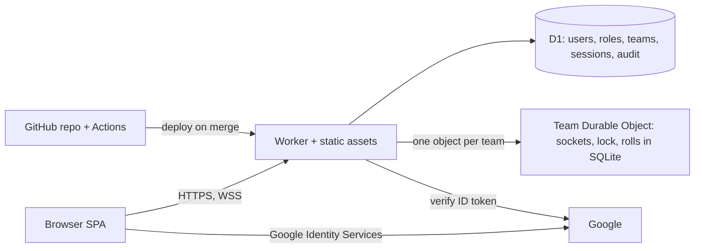

# Shadowrun Dice Roller: Free-Tier Spec Set

Status: draft. This set replaces the AWS design in `../specs`. The baseline in `../specs/00-current-state.md` is unchanged and still describes the implementation these stories start from.

## Goal and constraints

- Monthly cost of 0 USD. No purchased domain: the app runs on a `workers.dev` address.
- Keep as many of the requested features as the free tier allows: Google sign-in, stored profiles, Runner Teams, live shared rolls, a shared roll log kept 30 days, skins, user management, admin, GM and player roles, and GM rolls that players cannot see by default.
- Same incremental structure as the AWS set. Each story ships on its own.

## What is hosted where

| Piece | Where | Cost |
| :--- | :--- | :--- |
| Source, issues, specs, CI/CD | GitHub repository and Actions | Free for public repos. Private repos get a monthly minutes allowance (check current amount). |
| Static client and API | One Cloudflare Worker with static assets | Free plan |
| Users, roles, teams, sessions, audit | Cloudflare D1 (SQLite) | Free plan (limits not verified, see budget) |
| Live rooms, roll lock, roll storage, 30 day purge | One Cloudflare Durable Object per team (SQLite-backed) | Free plan (limits verified, see budget) |
| Sign-in | Google Identity Services | Free |

GitHub Pages is not used for the app. Pages cannot run WebSockets or a database, and serving the client from the same Worker gives one origin, first-party cookies, and no CORS. Pages remains an option for a solo-only copy of the client.

## Stories in implementation order

| # | Spec | Delivers | Effort |
| :--- | :--- | :--- | :--- |
| 00 | `../specs/00-current-state.md` | Baseline, unchanged | n/a |
| 01 | [Free platform](01-free-platform-github-cloudflare.md) | Repo, build, Worker, D1, Durable Object echo test, CI/CD | M |
| 02 | [Google sign-in and roles](02-google-sign-in-and-roles.md) | Sign-in spike, invite-only auth, users and roles, admin bootstrap | M |
| 03 | [User profiles](03-user-profiles.md) | Stored profile, profile page | S |
| 04 | [Skins](04-skins.md) | Data-driven skins, per-user choice | M |
| 05 | [User management](05-user-management.md) | Admin console, role changes, admin transfer, audit | M |
| 06 | [Runner teams](06-runner-teams.md) | Teams, membership, team GM | M |
| 07 | [Live shared rolls](07-live-shared-rolls.md) | WebSocket hub, server-issued seeds, deterministic replay | L |
| 08 | [Roll log and retention](08-roll-log-and-retention.md) | Shared log, 30 day purge | S to M |
| 09 | [GM hidden rolls](09-gm-hidden-rolls.md) | Hidden by default for the GM, reveal | M |
| 10 | [Free-tier operations and hardening](10-free-tier-operations-and-hardening.md) | Quota handling, backups, rate limits, audit of rolls, backlog | M |

Order is the same as the AWS set, for the same reasons. Story 01 includes an early WebSocket and Durable Object test because story 07 depends on it. Story 02 starts with a spike to confirm Google sign-in accepts a `workers.dev` origin, because every later story depends on sign-in.

## Free-tier budget

Verified means read from Cloudflare's Durable Objects pricing page on 2026-11-05. Unverified means from memory and must be checked in story 01 before relying on it.

| Limit (free plan) | Value | Status |
| :--- | :--- | :--- |
| Durable Object requests per day (includes WebSocket messages, alarms) | 100,000 | Verified |
| Incoming WebSocket messages count as requests at | 20 to 1 | Verified |
| Outgoing WebSocket messages and protocol pings | Not charged | Verified |
| Durable Object duration per day | 13,000 GB-s | Verified |
| Idle hibernated objects | Not billed for duration | Verified |
| Durable Object rows read / written per day | 5 million / 100,000 | Verified |
| Durable Object storage | 5 GB | Verified |
| Storage backend on free plan | SQLite only | Verified |
| Behavior at the limit | Operations fail with an error, no billing | Verified |
| Daily reset | 00:00 UTC (7 PM US Eastern in winter, 8 PM in summer) | Verified |
| Worker requests per day | about 100,000 | Unverified |
| Worker CPU time per request | about 10 ms | Unverified |
| D1 rows read / written per day, storage | about 5 million / 100,000 / 5 GB | Unverified |
| Static asset requests | free and unlimited | Unverified |

The daily reset at 7 PM Eastern falls in the middle of an evening game night. Story 10 handles hitting a limit gracefully.

Estimated use, to be measured in story 10. A roll in a team of 6 is about 3 incoming messages from the roller plus 5 audit messages from spectators, which is about 0.4 request-equivalents, plus about 4 rows written.

| Scenario | Durable Object requests | Rows written | Share of daily limit |
| :--- | :--- | :--- | :--- |
| One team, 100 rolls | about 50 | about 400 | under 1 percent |
| Five teams, 200 rolls each | about 450 | about 4,000 | under 5 percent |
| 50 users sign in and each reconnects 5 times | about 250 plus sign-in Worker requests | few | under 1 percent |

## Key design decisions

1. One Worker serves the client and API on one origin, so session cookies are first-party and there is no CORS.
2. D1 holds identity and organization data (users, roles, profiles, teams, sessions, admin audit). D1 gives you a SQL console, so you can insert a user row and the admin role by hand.
3. Each team has one Durable Object. It owns that team's sockets, the roll lock, and the roll history in its own SQLite database. Hidden-roll privacy is enforced in this one place.
4. Roll randomness comes from the server. The Durable Object issues a seed for each roll. Every browser derives the throw from the seed and runs the same fixed-step physics. The roller cannot choose the throw. Spectators act as independent checkers of the roller's reported result (story 10).
5. Physics stays in the browser. Headless server simulation does not fit the free CPU limit.
6. Auth provider code sits behind a small interface so a different provider (Discord or GitHub OAuth) can replace Google if `workers.dev` is rejected.
7. No timers inside Durable Objects. Roll timeouts and the 30 day purge use alarms so idle objects can hibernate and cost nothing.

## Roles and permissions summary

- `admin`: exactly one, manages users, roles and all teams.
- `gm`: can be the GM of teams, rolls hidden by default.
- `player`: rolls in teams they belong to.
- Roles are additive. Details in 02, 05, 06 and 09. These match the AWS set.

## What you give up compared with the AWS design

- Postgres. D1 and Durable Object SQLite are SQLite, and D1 has no interactive transactions (use batches).
- Managed backups with a retention window you set. Replaced by a nightly export in story 10, and D1 point-in-time restore if available on the free plan (check).
- Headroom. Daily caps are hard stops. Fine for tens of users, not for a public launch.
- Server-side physics verification. Replaced by server-issued seeds and spectator checks.
- A custom domain, unless you buy one. Google sign-in may require one (spike in 02).
- Portability. Durable Objects are Cloudflare-specific.

## Open questions

| Question | Assumed default |
| :--- | :--- |
| Does Google sign-in accept a `workers.dev` origin on your consent screen? | Unknown. Spike in 02. Fallback is Discord or GitHub OAuth, or a bought domain at about 12 USD per year. |
| Public or private GitHub repo? | Public, so Actions are free. No secrets live in the repo. |
| Account setup | One Cloudflare account, `dev` and `prod` Workers and D1 databases. Check free-plan limits on database count. |
| Exactly one admin? | Yes, enforced by a unique index, with a transfer operation. |
| Does the admin see GM hidden rolls? | No, unless also that team's GM. |
| One GM per team? | Yes. |
| Does the GM visibility toggle reset after each roll? | Yes, back to hidden. |
| Expected scale | Under 50 users, under 10 per team, under 5 active teams at once. |

## Carried over unchanged from the AWS set

Roll rules, glitch and critical glitch logic, skin definitions and launch skins, permission matrices, role semantics, hidden-roll rules, 30 day retention, and the privacy statements. Where a story below says "as in" an AWS spec, the rule is the same and only the storage or transport changes.
